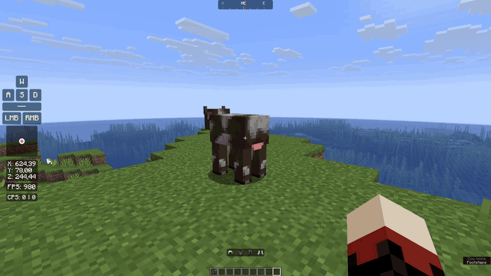
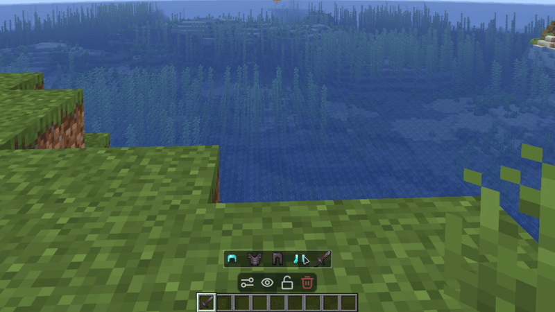
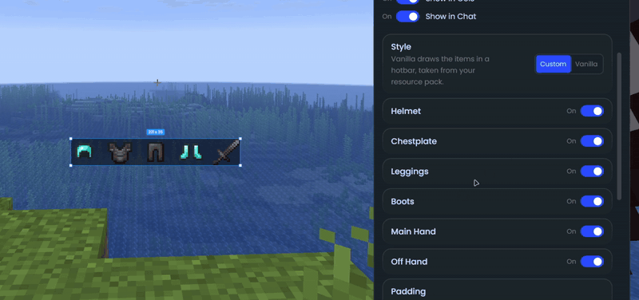
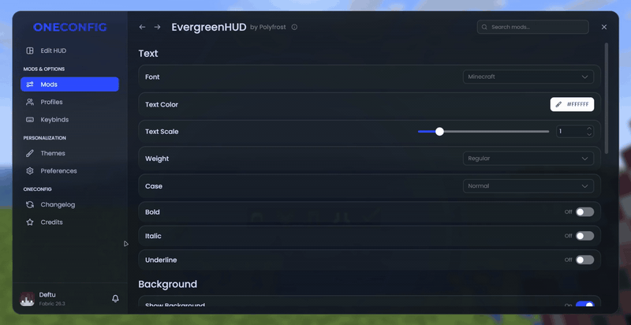

# EvergreenHUD

EvergreenHUD adds around 40 HUD elements to the OneConfig HUD editor. Place, scale and style whichever ones you want.

### Elements

- Combat: CPS, Keystrokes, Mouse Strokes, Combo, Reach, Block Place Count
- Player: Armor Status, Potion Effects, Inventory, Item Counter, Item Tracker, Item Lore, Saturation, Player Preview, Player Head
- World: Position, Facing, Direction, Speed, Biome, Block Above, Day, In Game Time, Entity Counter
- Performance: FPS, Ping, TPS, Memory, Server Address, Play Time, Resource Pack
- Clocks: Clock, Digital Clock
- Custom: Custom Text, Custom Image, Shape
- Online: Weather, Social Media Stats
- Battery (Windows laptops) and Shaders (with Iris)

### Some highlights

- Keystrokes with custom rows, colors and fade times, plus a trail for your mouse movement
- Armor Status with durability, percentage, item name or count next to each piece
- Inventory can show your ender chest, or the shulker box you're holding
- FPS with average, median and percentile values
- Combo and Reach for your last hits
- A compass strip that scrolls as you turn

Font, colors, background, corner radius, shadow and padding can be set for every element at once from the EvergreenHUD settings page.

## Compatibility

If you also use [VanillaHUD](https://modrinth.com/mod/vanillahud), the Potion Effects element can hide VanillaHUD's status effects so the two do not overlap.

## Supported versions

- Minecraft 1.8.9 on Ornithe.
- Minecraft 1.21.1-26.3 on Fabric.

EvergreenHUD needs [OneConfig](https://modrinth.com/mod/oneconfig) and Fabric Language Kotlin. The Fabric builds also need Fabric API.

## Support

- Report bugs and ask questions on the [Polyfrost Discord](https://polyfrost.org/discord).
- Check [Polyfrost Status](https://status.polyfrost.org/) if a Polyfrost service is down.
